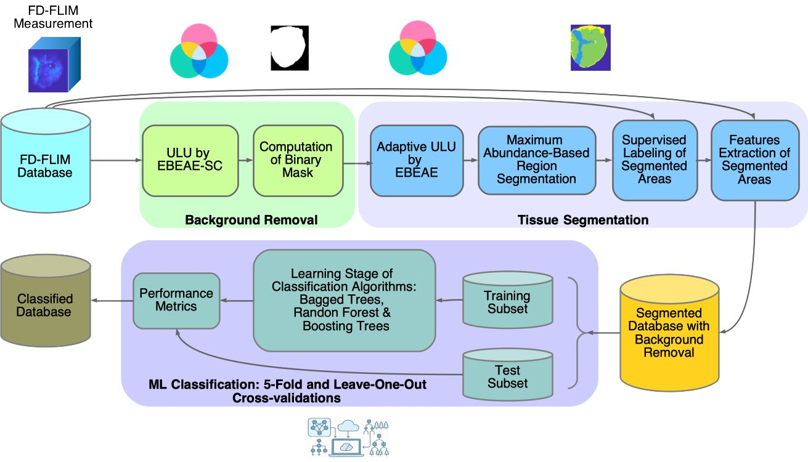

<!--
  TO DO BEFORE RELEASE (find & replace):
  1. R20XXx          ->  MATLAB release used
  2. License lines at the bottom (code and data) and add the LICENSE file
  3. PLOS ONE citation details once available
-->

# Tumor Diagnosis of Frequency-Domain FLIM Samples by a Hybrid Approach: Unsupervised Linear Unmixing + Machine Learning

[](https://doi.org/10.5281/zenodo.24144420)

Code and data to reproduce the results of the manuscript submitted to **PLOS ONE**.

**Authors:** Daniel Ulises Campos-Delgado, Jorge D. Cardenas, Miguel Velazquez-Duran, Omar Gutierrez-Navarro, Seyed Edriss Mirnia, Carissa Huynh, Yuan Li, V. Krishnan Ramanujan and Javier A. Jo.
**Contact:** 
<!--miguel.duran@uaslp.mx-->

---

## Summary

This work introduces a classification pipeline for tumor diagnosis of **frequency-domain fluorescence lifetime imaging microscopy (FD-FLIM)** samples. Unsupervised linear unmixing (ULU) is combined with tree-based machine learning (ML) to distinguish **tumor** from **non-tumor** tissue in snap-frozen *ex-vivo* human specimens (kidney, adrenal gland, ureter and urachal lesions).

- **Dataset:** 51 FD-FLIM samples (160 × 160 pixels × 63 features per sample), labeled by histopathological evaluation. Samples are numbered 1–51, as in Table I of the manuscript.
- **ULU methods:** EBEAE (Extended Blind Endmember and Abundance Extraction) and EBEAE-SC (with Spatial Coherence).
- **Classifiers:** bagged trees, random forest and boosting trees (AdaBoostM1).
- **Validation:** 5-fold and leave-one-out cross-validation.

## Methodology



The pipeline has three stages:

1. **Background removal.** EBEAE-SC with N = 2 endmembers (tissue and background; ρ = 0.01, µ = 0.1). The endmember with the lower mean calibrated absolute intensity (CAI) is assigned to the background. The binary mask is refined with morphological operations (disk, radius 8 px).
2. **Tissue segmentation.** Adaptive-order EBEAE (starts at N = 3 and reduces the order if an endmember is spatially insignificant, < 5 % of the ROI, or if endmembers are too similar, SAM < 10°; ρ = 0.1, µ = 0.1). Pixels are assigned to the endmember with maximum abundance. Segmented regions are labeled tumor / non-tumor from the histopathological report, and the mean 63-feature vector of each region is extracted.
3. **ML classification.** Bagged trees, random forest and boosting trees evaluated with 5-fold and leave-one-out cross-validation.

## Main results

**5-fold cross-validation (mean ± std on test folds)**

| Classifier | Accuracy | Precision | Recall | F1-score |
|---|---|---|---|---|
| Bagged trees | 85.88 ± 12.20 % | 88.97 ± 16.95 % | 90.00 ± 6.09 % | 88.56 ± 8.99 % |
| Random forest | 82.35 ± 15.00 % | 87.39 ± 17.66 % | 86.67 ± 12.17 % | 85.56 ± 10.78 % |
| Boosting trees | 82.35 ± 11.00 % | 82.47 ± 13.94 % | 89.44 ± 7.95 % | 85.17 ± 8.75 % |

**Leave-one-out cross-validation**

| Classifier | Accuracy | Precision | Recall | F1-score |
|---|---|---|---|---|
| Bagged trees | 87.06 % | 88.00 % | 89.80 % | 88.89 % |
| Random forest | 84.71 % | 84.62 % | 89.80 % | 87.13 % |
| Boosting trees | 84.71 % | 83.33 % | 91.84 % | 87.38 % |

Bagged trees obtained the numerically highest performance in both schemes; the Friedman test showed no statistically significant differences among classifiers in 5-fold CV.

---

## Repository contents

Legend:&nbsp; 📦 **included in this repository** &nbsp;|&nbsp; ⬇️ **downloaded from Zenodo** &nbsp;|&nbsp; ⚙️ **generated when running the code**

```text
.
├── README.md                              📦
├── CITATION.cff                           📦
├── LICENSE                                📦
├── .gitignore                             📦
├── images/
│   └── pipeline.png                       📦 methodology diagram
│
├── EBEAE_FD_FLIM.mlapp                    📦 GUI: preprocessing, labeling and database creation
├── appRoot.m                              📦 folder of the app (paths do not depend on the current folder)
├── GetTitle.m                             📦 file name and histology of each sample (1-51)
├── LoopOverWavelengths.m                  📦 reads the HDF5 files and builds the feature tensor
├── BackRem.m                              📦 background removal + call to segmentation
├── MaskNoise.m                            📦 binary mask of the tissue
├── SegFLIM.m                              📦 adaptive-order tissue segmentation
├── checkIter.m                            📦 stopping criteria (5 % / 10°)
├── ComputeLinearUnmixing.m                📦 wrapper of the unmixing algorithms
├── Classorder.m                           📦 formats the results of each sample
├── ShowResult.m                           📦 error metric, abundance maps and classification maps
├── LabelPixelLevel.m                      📦 mean features per segmented region (Labels tab)
├── TableDatabase.m                        📦 database as table (Create Database tab)
├── EBEAE.m  EBEAESN.m  EBEAESN2.m         📦 EBEAE family of unmixing algorithms
├── EBEAESNTV.m  EBEAETV.m  EBEAETV_Mask.m 📦
│
├── Database/
│   ├── README.md                          📦
│   └── *.hdf5                             ⬇️ the 51 FD-FLIM samples (Zenodo; not stored on GitHub)
│
├── GlobalResults/                         ⚙️ results of each sample (time, error, class percentages)
├── EndMembersFeatures/                    ⚙️ estimated endmembers
├── PixelFeatures/                         ⚙️ pixel features of each sample
├── MaxAbundance/                          ⚙️ segmentation by maximum abundance
├── BackgroundData/                        ⚙️ background mask and background features
├── ImagesSegmentation/                    ⚙️ abundance and classification maps (.png)
├── Labels/
│   └── Labels.mat                         ⚙️ manual labels (Labels tab)
│
└── DatasetFinal/
    └── MachineLearning/
        ├── DatabaseNum_Article51.mat      📦 database with the classification used by the authors (51 samples)
        ├── DatabaseNum.mat                ⚙️ created by "Create Database > Generate" (or a copy of the file above)
        ├── ModelML.m                      📦 5-fold cross-validation (Tables III and IV)
        ├── ModelML_LOOCV.m                📦 leave-one-out cross-validation (Table V)
        └── Significance_Fried_5Fold.m     📦 Friedman test (Table IV)
```

### About `DatabaseNum_Article51.mat`

This file contains the database **with the classification used by the authors** (segmented regions, labels and 63 features, for the 51 samples). Use it if you want to recover exactly the data behind the reported results without repeating the segmentation and the manual labeling: copy it to `DatabaseNum.mat` (see Quick start A). The file generated by *Create Database > Generate* is saved with the name `DatabaseNum.mat` and **does not overwrite** this one.

Structure: variable `Database1`; each row is a segmented region (mean feature vector) or the background of a sample; columns 1–63 are the features, column 64 is the label (1 = non-tumor, 2 = tumor, 0 = unknown, 8 = background noise) and column 65 is the sample number (1–51).

## Data

The FD-FLIM database (51 samples, ~0.9 GB) is available at Zenodo:

- DOI: **https://doi.org/10.5281/zenodo.24144420**
- Record: https://zenodo.org/records/24144421

Download the `.hdf5` files to the `Database/` folder. They are only needed to repeat the segmentation (Quick start B). The tissue specimens were obtained from patients undergoing surgery at Cedars-Sinai Medical Center, Los Angeles, CA (IRB Pro00043021), and imaged at the University of Oklahoma.

Each sample is a tensor of **160 × 160 pixels × 63 features** from seven excitation–emission channels (four at 375 nm and three at 445 nm excitation): calibrated intensities (CAI, InterCNI, IntraCNI), frequency-calibrated modulation (FCM) and frequency-calibrated phase (FCP).

## Requirements

- MATLAB R2021a or later (developed and tested with R2024a)
- Statistics and Machine Learning Toolbox (classifiers and Friedman test)
- Image Processing Toolbox (morphological operations of the mask)


## Quick start

### A. Reproduce the ML results with the authors' classification (no raw data needed)

1. In MATLAB, go to `DatasetFinal/MachineLearning`.
2. Use the authors' database:
   ```matlab
   copyfile('DatabaseNum_Article51.mat', 'DatabaseNum.mat')
   ```
3. Run, with **Run (F5)**:
   - `ModelML.m` → Table III (5-fold)
   - `Significance_Fried_5Fold.m` → Table IV (run it right after `ModelML.m`, without clearing the workspace)
   - `ModelML_LOOCV.m` → Table V

### B. Repeat the whole pipeline from the raw data

1. Download the `.hdf5` files from Zenodo to `Database/`.
2. In MATLAB, go to the root folder of the repository and run `EBEAE_FD_FLIM`.
3. **Preprocessing** tab: samples 1 to 51. Background removal with EBEAE-SC (option *EBEAE-TV* in the GUI, N = 2, ρ = 0.01) and segmentation with EBEAE (ρ = 0.1).
4. **Labels** tab: assign *non-tumor (1) / tumor (2) / NA (3)* to each endmember, samples 1 to 51 in a single run.
5. **Create Database** tab: press *Generate*. The result is saved as `DatasetFinal/MachineLearning/DatabaseNum.mat`.
6. Run the ML scripts as in Quick start A (step 3).

> The database generated in B can differ slightly from `DatabaseNum_Article51.mat`: the unmixing algorithms have a random initialization and the labeling is manual. To obtain exactly the reported results, use Quick start A.

## Description of the main files

**Segmentation (repository root)**

- **`EBEAE_FD_FLIM.mlapp`** — graphical interface with three tabs: *Preprocessing* (background removal and tissue segmentation), *Labels* (supervised labeling of the segmented regions) and *Create Database* (builds `DatabaseNum.mat`).
- **`appRoot.m`** — returns the folder where the app is installed, so that all inputs and outputs are located relative to it, independently of the current MATLAB folder.
- **`GetTitle.m`** — returns the name of the HDF5 file and the histopathological composition (tumor, non-neoplastic, necrosis/hemorrhage, normal) of a given sample number.
- **`LoopOverWavelengths.m`** — reads one HDF5 file and assembles the feature tensor (intensity, modulation and phase for each excitation–emission channel).
- **`BackRem.m`** — configures and runs the unmixing for one sample: first the background removal and then the call to the segmentation; it returns the results, endmembers, features and abundances.
- **`MaskNoise.m`** — builds the binary mask from the abundance maps (the endmember with the lowest mean CAI is the background) and refines it with morphological operations.
- **`SegFLIM.m`** — iterative tissue segmentation: starts with three endmembers and reduces the order when the stopping criteria are met; classifies each pixel by its maximum abundance.
- **`checkIter.m`** — stopping criteria of the adaptive order: spatial contribution smaller than 5 % or spectral angle (SAM) between endmembers smaller than 10°.
- **`ComputeLinearUnmixing.m`** — common interface to the EBEAE algorithms (selection of the method, parameters and outputs: endmembers, abundances, reconstruction and percentage of each class).
- **`Classorder.m`** — formats the results of a sample into a vector (computation time, estimation error, class percentages sorted in descending order and model order).
- **`ShowResult.m`** — computes the estimation error and plots/saves the abundance maps and the classification map.
- **`LabelPixelLevel.m`** — for the *Labels* tab: assigns every pixel to its maximum-abundance endmember and returns the mean feature vector of each segmented region.
- **`TableDatabase.m`** — converts the database into a table (62 features and the label as a categorical variable) for display in the *Create Database* tab.
- **`EBEAE.m`, `EBEAESN.m`, `EBEAESN2.m`, `EBEAESNTV.m`, `EBEAETV.m`, `EBEAETV_Mask.m`** — implementations of the EBEAE family; the variants *SN* add a sparse-noise component and the variants *TV* add the total-variation (spatial coherence) regularization used by EBEAE-SC; `EBEAETV_Mask.m` works on the region of interest defined by the mask.

**Machine learning (`DatasetFinal/MachineLearning/`)**

- **`ModelML.m`** — 5-fold cross-validation of the three classifiers; prints the metrics of every fold, shows the confusion chart of each fold and model, and prints the final mean ± standard deviation (Table III). It leaves the results in the workspace for the statistical test.
- **`ModelML_LOOCV.m`** — leave-one-out cross-validation of the three classifiers (Table V), with the list of misclassified samples and the confusion charts.
- **`Significance_Fried_5Fold.m`** — Friedman test (and multiple comparisons when significant) on the 5-fold metrics (Table IV).


## Citation

If you use this code or data, please cite:

```
Campos-Delgado D.U., Cardenas J.D., Velazquez-Duran M., Gutierrez-Navarro O., Mirnia S.E.,
Huynh C., Li Y., Ramanujan V.K., Jo J.A. Tumor Diagnosis of Frequency-Domain FLIM Samples
by a Hybrid Approach: Unsupervised Linear Unmixing + Machine Learning. PLOS ONE (submitted).
Dataset: https://doi.org/10.5281/zenodo.24144420
```


